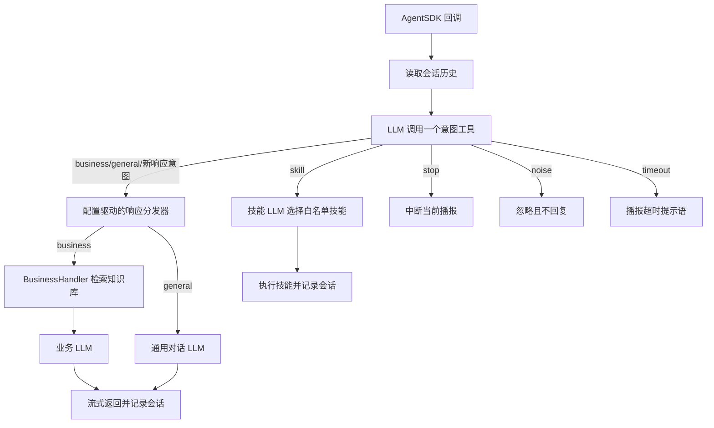

# AgentSDK Sample Code

[简体中文](README.md) | [English](README_EN.md)

本项目是一个基于灵心 AgentSDK 的医院导诊机器人示例工程。应用接收当前语言配置对应的语音识别（ASR）文本，通过 LLM 完成意图路由，并将请求分发至医院业务咨询、通用对话或机器人技能处理流程。

> 本示例提供简体中文和英文两套语言配置。每个进程在启动时通过 `config.json` 中的 `locale_file` 选择一种语言，不支持运行时自动识别或切换语言。

> **环境说明：** 本项目使用灵心相关平台的正式环境。应用凭据、智能体、知识库和运行时配置必须均来自正式环境。

## 主要功能

- 通过 LLM 函数调用（function calling）从动态注册的意图工具中选择唯一的顶层意图，无需模型输出固定的 JSON 意图标签。
- `BusinessHandler` 显式检索医院知识库，再由业务 LLM 生成回答。
- `general` 分支由就诊服务助手处理问候、一般知识问答及其他非就诊请求。
- 技能分支只执行 `config.json` 白名单中的 AgentSDK 技能。
- 在进程内存中保存单个机器人实例的最近多轮会话。
- 机器人播报期间不处理新的 `business`、`general` 或 `skill` 请求；`stop` 仍可用于中断播报。

## 处理流程



请求处理流程如下：

1. AgentSDK 将 ASR 结果传递给应用，应用读取最近的会话历史。
2. `ScopeRouter` 将动态注册的响应意图以及 `skill/stop/noise` 注册为无参数函数工具，并要求 LLM 恰好调用其中一个。响应意图由分发器交给对应的处理器。
3. `business` 请求由 `BusinessHandler` 显式检索医院知识库，将参考资料加入当前 `user` 角色消息后调用业务 LLM；`general` 请求由就诊服务助手回答；`skill` 请求仅能执行本地白名单中的技能。
4. `stop`、`noise` 和 `timeout` 由主流程直接处理；成功回答和技能结果会写入内存会话，供下一轮使用。

### 意图说明

| 意图 | 含义 | 程序行为 |
|---|---|---|
| `business` | 医院导诊、就医流程、院内位置和症状咨询等 | `BusinessHandler` 检索知识库后调用业务 LLM |
| `general` | 问候、一般知识问答及其他非就诊请求 | 调用通用对话 LLM |
| `skill` | 请求机器人执行已配置动作或播放音乐 | 技能 LLM 通过函数调用选择白名单内的技能 |
| `stop` | 请求停止当前回复或动作 | 调用中断接口，不生成新回复 |
| `noise` | 结合上下文后仍无法识别的噪声或 ASR 碎片 | 忽略且不回复 |
| `timeout` | 路由模型请求超时、调用失败或结果无效 | 播报已配置的超时提示语 |

## 项目结构

```text
sample_code/
├── main.py                    # 应用入口和 AgentSDK 回调
├── app_config.py              # 配置加载与校验
├── scope_router.py            # LLM 意图路由和结果解析
├── route_dispatcher.py        # 响应意图注册与分发
├── handlers/                  # 由分发器动态加载的响应处理器
│   ├── __init__.py
│   ├── business_handler.py
│   └── general_chat_handler.py
├── skill_handler.py           # 技能白名单校验与执行
├── skill_config.py            # 技能配置解析
├── conversation_manager.py    # 单机器人内存会话
├── knowledge_retriever.py     # 远程知识库检索
├── llm_client.py              # OpenAI-compatible LLM 客户端
├── config.json                # 技术运行配置
├── config/
│   ├── prompt_layout.json     # 开发人员维护的提示词结构
│   └── locales/
│       ├── zh-CN.json         # 简体中文提示词与话术
│       └── en-US.json         # 英文提示词与话术
├── knowledge_base/            # 用于导入灵心平台的知识库文件
│   ├── hospital_qa_curated_250_zh.xlsx
│   └── hospital_qa_curated_250_en.xlsx
├── .env.example               # 环境变量名称示例
├── requirements.txt           # 固定版本依赖
├── pyproject.toml             # Python 项目元数据
├── README.md                  # 中文说明
└── README_EN.md               # English documentation
```

## 环境要求

- Python 3.10 或更高版本。
- `linksoul-agentsdk==1.4.0a0`。该 SDK 需要下载官方 wheel 或源码包后离线安装；本示例按该版本开发和验证。
- 可访问 AgentSDK、OpenAI 兼容的 LLM 服务，以及启用知识库时所需的检索接口。
- 使用与所选语言配置一致的简体中文或英文输入。

## 启动应用

### 1. 安装依赖

先参考 [AgentSDK 开发包下载文档](https://open.agibot.com/docs/linksoul/agentsdk_docs/python/v140/zh#%E5%BC%80%E5%8F%91%E5%8C%85%E4%B8%8B%E8%BD%BD)，下载与当前操作系统和 Python 版本匹配的 wheel 或源码包，并将安装包复制到部署环境。AgentSDK 需要从本地安装，本项目不会自动下载该 SDK。

创建虚拟环境后，先离线安装 AgentSDK，再安装项目依赖：

```bash
cd /path/to/sample_code
python3 -m venv .venv
source .venv/bin/activate
python -m pip install --upgrade pip
python -m pip install /path/to/agentsdk-package.whl
python -m pip install -r requirements.txt
```

如果下载的是源码包，将 AgentSDK 安装命令替换为：

```bash
python -m pip install /path/to/agentsdk-source-package
```

`/path/to/agentsdk-package.whl` 和 `/path/to/agentsdk-source-package` 需要替换为实际的本地文件或目录路径。`requirements.txt` 中声明了已验证的 AgentSDK 版本；当本地已安装相同版本时，`pip` 会复用该安装结果。

Windows PowerShell 使用：

```powershell
python -m venv .venv
.\.venv\Scripts\Activate.ps1
python -m pip install --upgrade pip
python -m pip install C:\path\to\agentsdk-package.whl
python -m pip install -r requirements.txt
```

### 2. 获取 AgentSDK 凭据

登录[灵心开放平台](https://open.agibot.com/)，创建应用并获取 AgentSDK 连接所需的应用凭据：

| 环境变量 | 平台信息 |
|---|---|
| `AGIBOT_APP_ID` | 应用 ID |
| `AGIBOT_APP_KEY` | 应用 Key |
| `AGIBOT_APP_SECRET` | 应用 Secret |

请妥善保管上述凭据，不得将其写入 `config.json` 或提交至 Git 仓库。第 4 步完成智能体配置后，还需记录对应的 Agent Code。

### 3. 配置各模块的 LLM

本项目通过 OpenAI-compatible 接口调用 LLM。需要在 `config.json` 中检查并配置以下四处：

| 配置路径 | 用途 | API 密钥环境变量 |
|---|---|---|
| `scope_router.llm` | 顶层意图路由 | `SCOPE_ROUTER_LLM_API_KEY` |
| `skill_handler.llm` | 技能选择 | `SCOPE_ROUTER_LLM_API_KEY` |
| `reply_routes.general.llm` | 非就诊问题回答 | `GENERAL_CHAT_LLM_API_KEY` |
| `reply_routes.business.llm` | 医院业务和导诊回答 | `BUSINESS_LLM_API_KEY` |

每处 LLM 配置都需要设置 `base_url`、`model`、`temperature`、`max_tokens` 和超时等参数。`base_url` 填写 API 根地址，不要填写完整的 `/chat/completions` 地址。

`config.json` 中的 `api_key_env` 表示环境变量名称，不包含实际 API 密钥。不应在配置文件中添加或硬编码 `api_key`；实际密钥应在第 5 步通过环境变量注入。多个模块共用同一模型服务时，对应的环境变量可以设置为同一密钥。

例如，使用外部火山方舟模型时，业务回答模型可配置为：

```json
{
  "provider": "openai_compatible",
  "base_url": "https://ark.cn-beijing.volces.com/api/v3",
  "api_key_env": "BUSINESS_LLM_API_KEY",
  "model": "ep-your-endpoint-id",
  "temperature": 0.1,
  "max_tokens": 512,
  "timeout_seconds": 5,
  "business_timeout_seconds": 10,
  "stream": true
}
```

其他三处 LLM 同样填写方舟的 `base_url` 和推理接入点 ID（例如 `ep-...`），同时保留所在模块对应的 `api_key_env`、`max_tokens` 和 `stream` 设置。`timeout_seconds` 是底层 HTTP 请求超时，`business_timeout_seconds` 是应用最多等待该次调用结果的时间。

`extra_body` 是可选的厂商扩展请求体。当前默认配置通过它传递 `thinking=disabled`；如果目标服务不支持该扩展，删除对应 LLM 配置中的整个 `extra_body`。

### 4. 在灵心平台配置智能体和知识库

登录[灵心平台](https://linksoul.agibot.com/zh-cn/agent)，创建或选择用于运行本示例应用的智能体，记录其 Agent Code，并在第 5 步将该值设置为 `AGIBOT_AGENT_CODE`。

首先在 `config.json` 顶层设置 `locale_file`。以下片段仅展示该字段。中文部署配置：

```json
{
  "locale_file": "config/locales/zh-CN.json"
}
```

英文部署配置：

```json
{
  "locale_file": "config/locales/en-US.json"
}
```

然后为该智能体创建并绑定医院知识库。每次部署仅上传与 `locale_file` 所选语言对应的知识库文件：

- `locale_file` 为 `config/locales/zh-CN.json` 时，上传 `knowledge_base/hospital_qa_curated_250_zh.xlsx`。
- `locale_file` 为 `config/locales/en-US.json` 时，上传 `knowledge_base/hospital_qa_curated_250_en.xlsx`。

单语言知识库应仅包含对应语言的文件。确认文件已完成解析和索引，且知识库已绑定到 `AGIBOT_AGENT_CODE` 所指定的智能体。当 `reply_routes.business.knowledge_base.enabled` 为 `true` 时，`BusinessHandler` 将检索该智能体关联的知识库。

完成平台配置后，在 `config.json` 的 `reply_routes.business.knowledge_base` 中配置检索参数：

```json
{
  "reply_routes": {
    "business": {
      "knowledge_base": {
        "enabled": true,
        "api_url": "https://open.agibot.com/api/V1/open-portal/app/retriever/search/agent_kb",
        "top_k": 5,
        "rerank": true,
        "check_qa_first": true,
        "score_threshold": 0.1,
        "timeout_seconds": 5,
        "business_timeout_seconds": 5
      }
    }
  }
}
```

上述片段仅展示知识库配置路径，应与 `business` 中已有的 `handler` 和 `llm` 配置合并，不应覆盖整个 `business` 配置块。

| 字段 | 含义 |
|---|---|
| `enabled` | 是否启用知识库检索。设为 `false` 时，`BusinessHandler` 跳过知识库检索，直接调用业务 LLM |
| `api_url` | 知识库检索接口地址，必须与智能体和应用凭据所在环境一致 |
| `top_k` | 单次检索请求的最大返回条数 |
| `rerank` | 是否要求知识库服务对候选结果进行重排 |
| `check_qa_first` | 是否优先匹配结构化问答知识 |
| `score_threshold` | 传递给知识库服务的最低相关度阈值，用于过滤低相关度结果 |
| `timeout_seconds` | 知识库 HTTP 请求的底层网络超时时间，单位为秒 |
| `business_timeout_seconds` | 应用等待整次知识库检索结果的最长时间，单位为秒 |

知识库请求复用 `AGIBOT_APP_ID`、`AGIBOT_APP_KEY`、`AGIBOT_APP_SECRET` 和 `AGIBOT_AGENT_CODE`，无需另外配置知识库密钥。

### 5. 导入环境变量并启动

Linux/macOS 示例：

```bash
export AGIBOT_APP_ID="your_app_id"
export AGIBOT_APP_KEY="your_app_key"
export AGIBOT_APP_SECRET="your_app_secret"
export AGIBOT_AGENT_CODE="your_agent_code"
export SCOPE_ROUTER_LLM_API_KEY="your_scope_router_llm_api_key"
export GENERAL_CHAT_LLM_API_KEY="your_general_chat_llm_api_key"
export BUSINESS_LLM_API_KEY="your_business_llm_api_key"

python -m json.tool config.json >/dev/null
python -m json.tool config/prompt_layout.json >/dev/null
python -m json.tool config/locales/zh-CN.json >/dev/null
python -m json.tool config/locales/en-US.json >/dev/null
python main.py
```

`.env.example` 只展示变量名称，程序不会自动加载 `.env`。请在启动 `main.py` 的同一 shell 中执行 `export`，或通过容器/部署系统注入这些变量。按 `Ctrl+C` 可停止应用。

## 验证应用运行状态

启动应用后，按以下顺序进行验证：

1. 启动后没有配置错误或 Python 异常。
2. 日志出现 `application_initialized`，表示 SDK 初始化调用已完成。
3. 日志出现 `agent_auth_succeeded`，表示 AgentSDK 已成功鉴权并建立连接。
4. 对机器人说一句话后，日志依次出现 `conversation_user_input`、`conversation_intent` 和 `conversation_robot_response`。
5. 机器人能够播报回答或执行已配置技能。

如果日志仅包含 `application_initialized` 而没有 `agent_auth_succeeded`，表示应用尚未完成 AgentSDK 鉴权。请检查灵心开放平台的应用凭据、环境一致性和网络连接。

灵心平台的智能体页面提供模拟机器人对话功能。完成上述检查后，可先在该页面与智能体进行对话，验证意图路由、知识库检索、文本回答和技能调用是否符合预期。平台模拟对话验证通过后，再将智能体绑定到目标机器人，并在实体设备上完成语音交互和动作执行测试。

## 配置说明

### 配置文件职责

配置文件按技术参数、提示词结构和语言内容进行划分：

| 文件 | 作用 |
|---|---|
| `config.json` | AgentSDK、LLM、会话、处理器、知识库和技能调用等运行参数 |
| `config/prompt_layout.json` | 开发人员可调整的提示词拼接结构和占位符 |
| `config/locales/zh-CN.json` | 简体中文的意图说明、提示词、播报话术、知识库标签和技能文本 |
| `config/locales/en-US.json` | 对应的英文语言内容 |

`config.json` 顶层的 `locale_file` 指定语言配置文件，`prompt_layout_file` 指定提示词结构文件。中文部署使用 `config/locales/zh-CN.json`，英文部署使用 `config/locales/en-US.json`。语言在进程启动时确定，不会根据单次请求自动切换。

语言配置文件仅保存特定语言的文本，不使用 `{value}` 形式的程序插值模板。占位符、标点、换行和组合顺序由 `prompt_layout.json` 定义；应用启动时会校验模板名称和占位符。

### 修改提示词

提示词不在 `config.json` 中修改。请根据部署语言编辑对应的语言配置文件：

- 中文：`config/locales/zh-CN.json`
- 英文：`config/locales/en-US.json`

| 配置路径 | 用途 |
|---|---|
| `scope_router.system_prompt` / `user_prompt` | 顶层意图路由提示词 |
| `scope_router.control_routes` | `skill`、`stop` 和 `noise` 的工具描述 |
| `skill_handler.system_prompt` / `user_prompt` | 技能选择提示词 |
| `reply_routes.general.system_prompt` / `user_prompt` | 通用对话回答提示词 |
| `reply_routes.business.system_prompt` / `user_prompt` | 医院业务和导诊回答提示词 |
| `reply_routes.business.knowledge_base` | 知识库参考资料说明、空结果和异常结果文本 |
| `reply_routes.<route>.description` | 生成顶层意图函数的描述，用于意图路由 |
| `skill_texts` | 技能描述和技能执行后的播报文本 |

`config/prompt_layout.json` 定义用户输入和知识库片段的拼接结构。只有在需要调整占位符、字段顺序或消息布局时才修改该文件。如果项目同时发布中英文版本，修改提示词时应同步维护两个语言配置文件。

### 修改运行参数和环境变量

- `config.json` 用于修改语言选择、AgentSDK 地址、LLM 连接参数、会话限制、知识库检索参数和技能白名单。
- `config.json` 中的 `*_env` 字段仅定义环境变量名称，不存储凭据或 API 密钥。
- `.env.example` 列出项目需要的环境变量，仅作为配置模板。程序不会自动加载 `.env` 文件。
- 实际凭据和 API 密钥必须通过启动 `main.py` 的同一 shell、容器配置或部署系统注入。导入示例见“启动应用”第 5 步。

`config.json` 包含：

| 配置段 | 作用 |
|---|---|
| `agent` | 必填的 AgentSDK 地址及凭据环境变量 |
| `scope_router` | 通过函数调用选择唯一顶层意图工具的模型 |
| `skill_handler` | 通过函数调用选择具体技能的模型 |
| `conversation` | 会话开关、过期时间和容量限制 |
| `reply_routes` | 响应意图的处理器、LLM 和知识库技术参数 |
| `skill_actions` | 允许执行的 AgentSDK 技能 ID、SDK 语义和参数 |

`agent.sdk_url` 必须在 `config.json` 中明确配置，代码不提供默认 AgentSDK URL。

当前语言配置中的 `scope_router.system_prompt` 定义通用路由规则，`control_routes` 定义 `skill/stop/noise` 工具说明。应用启动时，已注册 `reply_routes` 的名称和 `description` 会被动态转换为函数工具，因此新增响应意图无需修改 `scope_router.py`。`timeout` 是应用内部的失败状态，不会注册为可供模型调用的工具。

知识库只由 `BusinessHandler` 调用。完整的运行参数、字段含义和配置方法见“启动应用”第 4 步。启用时，还必须在当前语言配置中提供以下文本：

- 当前语言配置中的同路径配置：检索内容使用约束，以及空结果和异常结果的提示文本。
- `language.knowledge_query_texts`：知识库检索查询中“当前问题、最近对话、用户、助手”的本地化标签。检索查询包含当前问题和最近 4 条对话消息。

当前配置的技能包括飞吻、双手比心、挥手问候、告别和播放音乐。对应的动作值为 `blow_kiss`、`hand_heart`、`wave_hands`、`goodbye` 和 `play_music`，均不携带额外参数。`skill_name`、`skill_value` 和技能参数的语义见[灵心 AgentSDK 技能语义文档](https://open.agibot.com/docs/linksoul/agentsdk_docs/python/v140/zh/guide/skills)。意图路由器仅调用顶层 `skill` 工具；`SkillHandler` 随后将技能白名单转换为函数工具，并选择、校验具体技能。

## 会话与播报限制

- 会话只保存在当前进程内存中，进程重启后丢失。
- 默认在最后一次有效对话后空闲 40 秒清空历史，最多保留 6 轮、3000 字符；`noise` 只读取历史，不刷新空闲计时。
- 机器人在语音播报过程中，只有明确的停止指令会中断当前播报；其他输入无法打断机器人正在播报的内容。

## 新增响应意图

每个响应意图对应一个独立处理器文件。例如，如需新增 `registration` 意图，请创建 `handlers/registration_handler.py`：

```python
from base_handler import BaseHandler, HandlerContext


class RegistrationHandler(BaseHandler):
    def handle(self, context: HandlerContext) -> str:
        reply_text = self.llm(context.user_text, history=context.history)
        context.response.on_vlm_item_delta(
            context.event_id,
            context.item_id,
            reply_text,
        )
        context.response.on_vlm_item_done(context.event_id, context.item_id)
        context.response.on_vlm_done(context.event_id)
        return reply_text
```

再在 `config.json` 的 `reply_routes` 中注册技术配置：

```json
"registration": {
  "handler": "handlers.registration_handler:RegistrationHandler",
  "llm": {
    "provider": "openai_compatible",
    "base_url": "https://ark.cn-beijing.volces.com/api/v3",
    "api_key_env": "REGISTRATION_LLM_API_KEY",
    "model": "ep-your-endpoint-id",
    "stream": false
  },
  "knowledge_base": {"enabled": false}
}
```

然后在 `config/locales/zh-CN.json` 的同名 `reply_routes` 中添加语言文本：

```json
"registration": {
  "description": "挂号流程相关咨询",
  "waiting_replies": [],
  "system_prompt": "...",
  "user_prompt": "...",
  "timeout_reply_text": "系统当前繁忙，请稍后再试。"
}
```

`description` 会自动加入路由模型的意图说明，`waiting_replies` 用于配置该意图的等待提示语。处理器必须位于 `handlers/` 目录，文件名必须以 `_handler.py` 结尾，并继承 `BaseHandler`。`BaseHandler` 根据合并后的当前意图配置创建 `self.llm`；处理器可以直接调用该对象，也可以实现自定义处理逻辑。

新增响应意图需要添加处理器文件，并在技术配置和当前语言配置中添加同名配置，无需修改 `main.py`、`scope_router.py` 或 `route_dispatcher.py`。`timeout`、`noise`、`stop` 和 `skill` 为固定控制意图，不能注册到 `reply_routes` 中。

## 许可证

本项目采用 MIT 许可证，详情请参阅 [LICENSE](LICENSE)。
